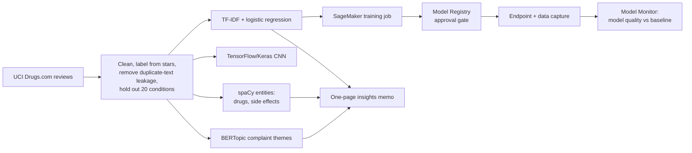

# patient-feedback-analyser

> **Status:** the local results below are measured. The SageMaker run (training job, registry gate, endpoint, Model Monitor) is written but has not run in AWS yet: it is waiting on an AWS service-quota increase, so no SageMaker results are reported.

What do patients complain about, and can a model flag negative feedback reliably enough to route it? This project
analyses **215,063 public patient drug reviews** (Drugs.com, UCI Machine Learning Repository, CC BY 4.0) and includes a pipeline to deploy the sentiment model on **AWS SageMaker** with a training job, **Model Registry** approval gate, a real-time endpoint
with data capture, and **Model Monitor** checking model quality on conditions the model never saw.



## What it shows

| Skill | Where |
|---|---|
| Text classification (sentiment), with bootstrap CIs and a test on unseen conditions | `pfa/models.py`, `pfa/metrics.py` |
| TensorFlow/Keras text model vs a strong linear baseline | `pfa/models.py` |
| Named entity extraction with spaCy (EntityRuler; scispaCy biomedical NER when installed) | `pfa/ner.py` |
| Topic modelling of complaints with BERTopic (NMF fallback, always labelled) | `pfa/topics.py` |
| Customer-feedback insight: side effects linked to bad experiences, with odds ratios and CIs | `pfa/ner.py`, `results/memo.md` |
| MLOps on AWS (pipeline written, run pending): SageMaker training job, Model Registry with approval gate, endpoint with data capture, Model Monitor (model quality), automatic clean-up | `aws/` |
| Data hygiene: duplicate-text leakage between the official train and test files removed | `pfa/data.py` |

## Results

<!-- RESULTS:START -->
**Data:** 215,063 reviews, 3,671 drugs, 837 conditions. Labels from the 10-star rating (≥7 positive, ≤4 negative; 19,185 neutral 5–6 left out). 26,819 test reviews were removed because the same text is in training (the dataset lists one review under several drug names). Train / valid / test / unseen = 84,419 / 9,221 / 13,480 / 9,950; *unseen* = 20 conditions never seen in training.

| Model | Macro-F1, test (95% CI) | ROC-AUC, test | Negative-review recall | Macro-F1, unseen conditions | Train time |
|---|---|---|---|---|---|
| TF-IDF (1-2 grams) + logistic regression | 0.868 (0.8614–0.8743) | 0.9471 | 0.8197 | 0.8412 (0.832–0.8493) | 4 s |
| TensorFlow/Keras CNN (embedding + Conv1D) | 0.8486 (0.8417–0.8553) | 0.9335 | 0.7881 | 0.8225 (0.8133–0.8304) | 86 s |

**Rating vs text:** the deployed model confidently contradicts the star rating on 0.7% of test reviews (sample in `results/disagreement_sample.csv`).

**Entities** (spacy.blank('en') + EntityRuler, 13,480 test reviews): SIDE_EFFECT 18,192, DRUG 15,550; 60% of reviews mention a side effect.
_Entity precision not hand-checked yet (`results/entity_sample.csv`)._

| Side effect | In negative reviews | In positive reviews | Odds ratio (95% CI) |
|---|---|---|---|
| **itching** | 5.9% | 1.7% | 3.59 (2.92–4.41) |
| **bleeding** | 3.8% | 1.9% | 1.97 (1.58–2.46) |
| **dizziness** | 6.0% | 3.2% | 1.95 (1.64–2.33) |
| **diarrhea** | 3.6% | 2.1% | 1.8 (1.45–2.25) |
| **mood swings** | 3.6% | 2.1% | 1.75 (1.4–2.18) |
| **acne** | 3.2% | 1.8% | 1.75 (1.39–2.22) |
| **headache** | 9.1% | 5.5% | 1.72 (1.49–1.98) |
| **fatigue** | 7.0% | 5.5% | 1.28 (1.1–1.49) |

_Odds ratio > 1: more common in negative reviews. Bold: whole 95% CI above 1. Mentions matching the review's own condition (e.g. 'anxiety' in an Anxiety review) are excluded._

**Complaint themes** (BERTopic (all-MiniLM-L6-v2, UMAP, HDBSCAN), 15,000 negative reviews, 43% unassigned):

- pill, birth, birth control, control, period — 17%
- burning, itching, yeast, cream, yeast infection — 9%
- pain, relief, muscle, pain relief, help — 5%
- anxiety, drug, medication, panic, attacks — 5%
- skin, acne, face, using, red — 5%
- shot, depo, bleeding, depo shot, period — 4%
- pressure, blood pressure, blood, bp, heart — 4%
- nexplanon, bleeding, period, months, got — 4%
<!-- RESULTS:END -->

## Run it

```bash
python3 run_and_push.py --local      # free, on your machine: data, models, entities, topics, memo
python3 run_and_push.py --aws        # SageMaker run (needs `aws configure`), then cleans up
python3 run_and_push.py --push-only  # commit and push results
```

## Honest limits

- Star ratings are a noisy proxy for sentiment; the share of confident rating/text disagreements is reported.
- Online reviews are self-selected and unverified: side-effect associations are not evidence of causation, and this is
  not hospital or clinical data.
- Entity extraction relies on a drug-name list and a side-effect lexicon (plus scispaCy when installed); precision is
  only claimed once the sampled entities are hand-checked (`python -m pfa.entity_precision`).
- The SageMaker monitoring run is a one-off job on simulated traffic (reviews from held-out conditions), not live
  production traffic.
