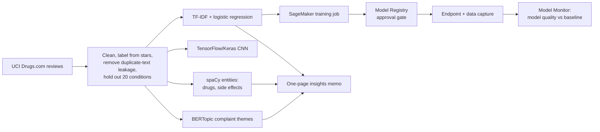

# patient-feedback-analyser

What do patients complain about, and can a model flag negative feedback reliably enough to route it? This project
analyses **215,063 public patient drug reviews** (Drugs.com, UCI Machine Learning Repository, CC BY 4.0) and deploys
the sentiment model on **AWS SageMaker** with a training job, **Model Registry** approval gate, a real-time endpoint
with data capture, and **Model Monitor** checking model quality on conditions the model never saw.



## What it shows

| Skill | Where |
|---|---|
| Text classification (sentiment), with bootstrap CIs and a test on unseen conditions | `pfa/models.py`, `pfa/metrics.py` |
| TensorFlow/Keras text model vs a strong linear baseline | `pfa/models.py` |
| Named entity extraction with spaCy (EntityRuler; scispaCy biomedical NER when installed) | `pfa/ner.py` |
| Topic modelling of complaints with BERTopic (NMF fallback, always labelled) | `pfa/topics.py` |
| Customer-feedback insight: side effects linked to bad experiences, with odds ratios and CIs | `pfa/ner.py`, `results/memo.md` |
| MLOps on AWS: SageMaker training job, Model Registry with approval gate, endpoint with data capture, Model Monitor (model quality), automatic clean-up | `aws/` |
| Data hygiene: duplicate-text leakage between the official train and test files removed | `pfa/data.py` |

## Results

<!-- RESULTS:START -->
_No results yet._
<!-- RESULTS:END -->

## Run it

```bash
python3 run_and_push.py --local      # free, on your machine: data, models, entities, topics, memo
python3 run_and_push.py --aws        # SageMaker run (needs `aws configure`), then cleans up
python3 run_and_push.py --push-only  # commit and push results
```

## Honest limits

- Star ratings are a noisy proxy for sentiment; the share of confident rating/text disagreements is reported.
- Online reviews are self-selected and unverified: side-effect associations are not evidence of causation, and this is
  not hospital or clinical data.
- Entity extraction relies on a drug-name list and a side-effect lexicon (plus scispaCy when installed); precision is
  only claimed once the sampled entities are hand-checked (`python -m pfa.entity_precision`).
- The SageMaker monitoring run is a one-off job on simulated traffic (reviews from held-out conditions), not live
  production traffic.
